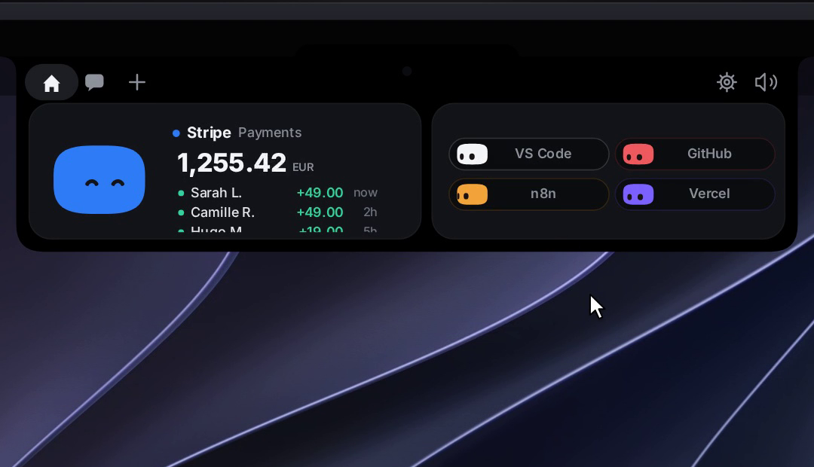
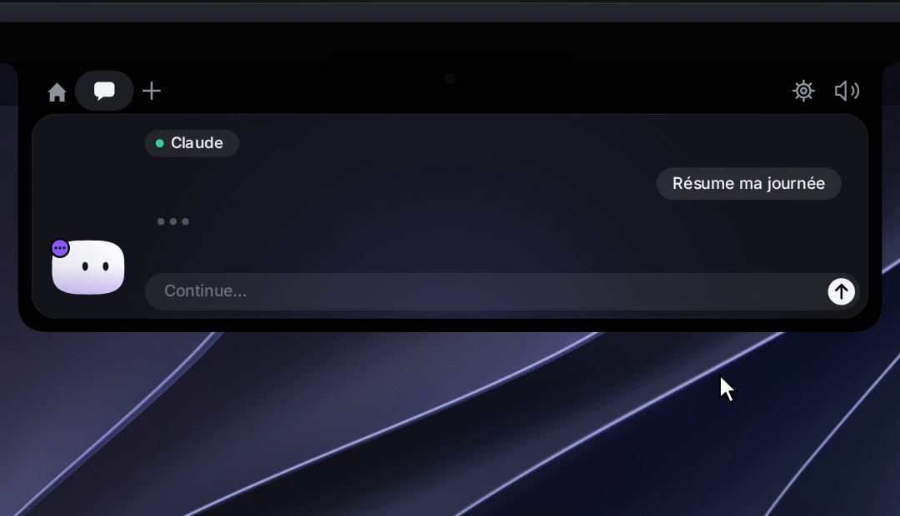

<div align="center">


# Coucou

**A tiny friend that lives in your Mac's notch and keeps an eye on your AI coding agent sessions.**

Approve permissions, watch your agents work, drop a file, chat with Claude — all without leaving what you're doing.

[](https://github.com/Louis-CFM/coucou/releases)


</div>

---

## Why

Some studios showed off gorgeous notch companions… and never let anyone use them.
**Coucou is the open version.** Every line of code is open source under the MIT License: read it, fork it, learn from it. The Coucou name, Mochi and the sounds stay © Louis Raillé (see [License](#license)).

Meet **Mochi**: a soft little squircle with big eyes that pops out of your notch, waves hello, follows your cursor with its eyes, gets annoyed when you poke it (and dizzy if you insist), and tells you the moment Claude Code needs you.

## Features

- 🤖 **Claude Code, Cursor, Codex, Gemini CLI, Antigravity, Copilot CLI, Muse Code, OpenCode, Amp, Hermes, Claude Desktop and other agents, live** — see every session in your notch: what it reads, edits and runs, step by step. Tag a hook payload with `coucou_agent` to give any agent its own pill (see [`docs/AGENTS.md`](docs/AGENTS.md)). Finished? Mochi does a happy little jump.
- See what Claude is editing, live in the notch: each file modification shows the file name and +N −M counts in the ticker, tap to read the full diff
- ✅ **Approve and answer from the notch** — Claude Code permission requests show up with **Allow / Deny / Always**; `AskUserQuestion` prompts show the choices right in the notch (single or multi-select, up to 4 questions). One click, or "Reply in terminal" to fall back to the CLI. Codex also gets Allow / Deny.
- 🧑‍💻 **Jump to the right terminal** — open the exact terminal window of a session.
- 💬 **Chat with Claude, Gemini, OpenAI, or a local model (Ollama / LM Studio)** — click the model name above the chat box to switch provider and pick a model. Cloud providers use your own API key; local providers connect to a server running on your Mac.
- 📊 **Claude plan usage** *(GitHub build)* — a small pill in the notch header shows your 5-hour and weekly Claude plan limits. Enable it from Settings → Agents → Plan usage. Pro and Max plans only.
- 📊 **Codex plan usage** *(GitHub build)* — a Codex pill next to it shows your Codex limits and how many free resets you have left, read from the Codex CLI. Turn it on in Settings → Agents → Plan usage.
- 📋 **Declare the tools you use** — open Settings → Active pills and pick your main workspace tool (VS Code, Cursor, Codex or Antigravity), then toggle up to 4 more: Gemini CLI, Anthropic, Google AI, OpenAI, Ollama, LM Studio and service integrations.
- 📎 **Drop a file on the notch** — Mochi turns into a box and swallows it, then ask a question about it or send it by email (Mail.app).
- 🖥️ **Mochi on the desktop** — drag Mochi out of the island to set him loose on your desktop: he floats as a 120 pt companion, follows your cursor, wears his outfit, reacts to alerts by flying home and flying back, and comes back where you left him on next launch.
- 🪟 **Drag Mochi onto any window** — attach that window as context for Claude.
- 🔌 **Integrations** — Stripe payments, n8n workflows, GitHub (open PRs, reviews requested, CI status), Vercel deployments, Resend emails, Notion, Cal.com. Each one gets its own little colored Mochi.
- 🎵 **Apple Music pill** *(GitHub build)* — add the Apple Music pill in Settings → Active pills to see what's playing and control playback from the notch; Mochi dances while it plays.
- 🎧 **Spotify pill** *(GitHub build)* — add the Spotify pill in Settings → Active pills: album cover, title and artist, a progress bar you drag to seek, play/pause, previous/next, shuffle, repeat and volume, right from the notch; Mochi dances while it plays.
- 👗 **Dress Mochi up** — right-click him for the wardrobe. He also dresses up for the seasons on his own.
- ⌨️ **Keyboard shortcuts** — open the chat, jump to an alert or a terminal, switch pills, mute, send Mochi to the desktop or open the wardrobe from anywhere; all customizable in Settings → Shortcuts.
- 🎭 **A real character** — idle breathing, blinks, eyes on a sphere that follow your mouse, emotes, 28 handcrafted sounds, a greeting on launch.
- 🔊 **Your own sounds** — drop a file named like one of Mochi's sounds (`finish.wav`, `approval.mp3`…) in Settings → General → Sound → **Open sounds folder** to replace it.
- 🎙️ **Dictate in the chat** *(GitHub build)* — click the mic next to the chat field and talk in any of your languages (Coucou picks the one you spoke, or right-click the mic to choose); speech recognition runs on your Mac when it supports it.
- 🫥 **Invisible when idle** — hides away when nothing is running, peeks out when you hover the notch.
- 🖥️ **Any Mac, notch or not** — on an iMac, a Mac mini, or a MacBook with its lid closed on an external display, Mochi sits in a small bar at the top of the screen. With several displays, pick his screen in Settings → General, or let him follow your mouse.
- 📅 **Weekly recap** — every Monday morning Coucou shows a summary of the past week: time coding, sessions, files, lines changed, commands, permissions, top agent and project, busiest day and longest session. Share it as a 1080 × 1920 image with Mochi — project names optional. All local, no sync.
- 🌍 **10 languages** — English, 中文, हिन्दी, Español, العربية, Français, বাংলা, Português, Русский, Bahasa Indonesia. Pick one in Settings → General → Language; community translations welcome.
- 🔒 **Private by design** — no telemetry, no account. Keys live in your macOS Keychain. The app only talks to the services you plug in.

<table>
<tr>
<td></td>
<td></td>
</tr>
<tr>
<td></td>
<td></td>
</tr>
</table>

## Versions

macOS releases are published as `v*` tags. See [CHANGELOG.md](CHANGELOG.md) for the full notes of each version.

| Version | Date | Highlights |
|---------|------|------------|
| [1.0.0](https://github.com/Louis-CFM/coucou/releases/tag/v1.0.0) | Oct 12, 2026 | Now called MyCoucou, Mac only, sessions report their real state, grouped by folder, working Resume |
| [0.2.3](https://github.com/Louis-CFM/coucou/releases/tag/v0.2.3) | Oct 8, 2026 | Terminal sessions, Spotify, a colour per Mochi, dictation in any language, open on hover, your own sounds |
| [0.2.2](https://github.com/Louis-CFM/coucou/releases/tag/v0.2.2) | Oct 8, 2026 | Choose Mochi's screen, Claude Desktop pill, Codex plan usage, full questions, safer settings.json |
| [0.2.1](https://github.com/Louis-CFM/coucou/releases/tag/v0.2.1) | Oct 7, 2026 | Hermes Agent support |
| [0.2.0](https://github.com/Louis-CFM/coucou/releases/tag/v0.2.0) | Oct 6, 2026 | Copilot CLI, Muse Code, OpenCode and Amp, weekly recap, 10 languages |
| [0.1.9](https://github.com/Louis-CFM/coucou/releases/tag/v0.1.9) | Oct 6, 2026 | Weekly recap card refinements |
| [0.1.8](https://github.com/Louis-CFM/coucou/releases/tag/v0.1.8) | Oct 5, 2026 | Weekly recap core |
| [0.1.7](https://github.com/Louis-CFM/coucou/releases/tag/v0.1.7) | Oct 4, 2026 | Keyboard shortcuts |
| [0.1.6](https://github.com/Louis-CFM/coucou/releases/tag/v0.1.6) | Oct 4, 2026 | Mochi on the desktop |
| [0.1.5](https://github.com/Louis-CFM/coucou/releases/tag/v0.1.5) | Oct 4, 2026 | Wardrobe and seasonal outfits, new launch greeting |
| [0.1.4](https://github.com/Louis-CFM/coucou/releases/tag/v0.1.4) | Oct 3, 2026 | Live diffs, GitHub pull requests, CI, reviews and contribution grid |
| [0.1.3](https://github.com/Louis-CFM/coucou/releases/tag/v0.1.3) | Oct 3, 2026 | Answer Claude's questions from the notch, plan usage, local models, Apple Music |
| [0.1.2](https://github.com/Louis-CFM/coucou/releases/tag/v0.1.2) | Oct 2, 2026 | Codex and Cursor support, the permission card stays until you answer |
| [0.1.1](https://github.com/Louis-CFM/coucou/releases/tag/v0.1.1) | Oct 2, 2026 | Gemini and OpenAI chat, more agents and pills, security hardening |
| [0.1.0](https://github.com/Louis-CFM/coucou/releases/tag/v0.1.0) | Sep 27, 2026 | First release: Mochi, Claude Code sessions, chat, file drop, integrations |

> **Note:** the repo ships the macOS app only. Earlier `windows-v*`, `linux-v*` and an iPhone App Store / TestFlight track were part of the project history and are no longer maintained.

## Install

### App Store

Coucou is coming to the **Mac App Store**: one click to install, automatic updates. The link will be here as soon as Apple publishes it.

The App Store build of the Mac app runs in Apple's sandbox, so a few features stay in the GitHub build: Claude plan usage, the Apple Music pill and attaching the front window to the chat.

### Download for macOS

1. Grab the latest `Coucou.zip` from [Releases](https://github.com/Louis-CFM/coucou/releases).
2. Unzip and move **Coucou.app** to `/Applications`.
3. Launch it, and click **Open** when macOS asks you to confirm. Updating from 0.1.0? macOS may ask you, once for each key you saved, to let Coucou use it: enter your Mac password and click **Always Allow**.

### Build from source

**macOS** — requirements: macOS 15+, Xcode 16+, [XcodeGen](https://github.com/yonaskolb/XcodeGen).

```bash
brew install xcodegen
git clone https://github.com/Louis-CFM/coucou.git
cd coucou/NotchBuddy
xcodegen
open NotchBuddy.xcodeproj   # then ⌘R
```

## Setup

Click the Coucou icon in the menu bar → **Settings…**

| What | Why | Where the key goes |
|---|---|---|
| **Claude Code hooks** | live sessions and approvals | **Install hooks** — Coucou backs up `~/.claude/settings.json`, merges its hooks and shows you the diff before writing anything |
| **Claude plan** *(GitHub build)* | Plan usage gauge in the notch header | **Install relay** in Settings → Agents → Plan usage, then enable "Show in the notch" |
| **Gemini CLI hooks** | Gemini CLI sessions in the island | **Install hooks** in Settings → Gemini CLI — backs up `~/.gemini/settings.json` |
| **Antigravity (agy) hooks** | agy sessions in the island | **Install hooks** in Settings → Antigravity — backs up `~/.gemini/config/hooks.json` |
| **Anthropic API key** | chat and questions about files | Settings → Anthropic API · Keychain |
| **Google AI API key** | chat with Google AI (Gemini) | Settings → Chat — other providers · Keychain |
| **OpenAI API key** | chat with OpenAI | Settings → Chat — other providers · Keychain |
| **Ollama server** | chat with local models via Ollama | Settings → Chat → Local models → **Connect** |
| **LM Studio server** | chat with local models via LM Studio | Settings → Chat → Local models → **Connect** |
| **Active pills** | choose which tools and agents appear in the island | Settings → Active pills |
| Stripe, n8n, GitHub, Vercel, Resend, Notion, Cal.com | the service pills | Keychain, all optional |

If Coucou isn't running, the hook exits immediately: **Claude Code is never blocked.**

### Supported agents

| Agent | How it connects |
|---|---|
| Claude Code | Settings → Claude Code → **Install hooks** |
| Gemini CLI | Settings → Gemini CLI → **Install hooks** |
| Antigravity | Settings → Antigravity → **Install hooks** |
| Cursor | Hooks installed automatically alongside Claude Code |
| Codex | `--agent codex` flag; Settings → Codex → **Install hooks** |
| Copilot CLI | `--agent copilot` flag + camelCase events |
| Muse Code | `--agent muse` flag |
| OpenCode | Plugin — **Settings → OpenCode Plugin → Install** |
| Amp | Plugin — **Settings → Amp Plugin → Install** |
| Hermes | Plugin — **Settings → Agents → Hermes → Install** |
| Any other | `--agent <name>` flag; see [`docs/AGENTS.md`](docs/AGENTS.md) |

OpenCode, Amp and Hermes use a plugin model rather than a hook command. Coucou installs the plugin file into `~/.config/opencode/plugins/`, `~/.config/amp/plugins/` and `~/.hermes/plugins/coucou/` respectively.

## Things to try

| Do this | Mochi does that |
|---|---|
| Hover the notch | peeks out and says hi 👋 |
| Click it | opens |
| Hover Mochi | blinks, eyes grow |
| Click Mochi | squish + annoyed |
| Click 3 times fast | 😵‍💫 dizzy for a few seconds |
| Drag a file onto the island | turns into a box and swallows it |
| Drag Mochi onto a window | attaches it as context |
| Click the model name above the chat box | switch AI provider or model |

## How it works

- **Island**: a borderless `NSPanel` hugging the notch, driven by a small state machine (`hidden → petit → home`).
- **Character**: drawn in SwiftUI `Canvas` + `TimelineView` at 60 fps — squircle body, eyes projected on a sphere, spring animations. No Rive, no Lottie, no images.
- **Claude Code**: a tiny `nb-hook` script receives hook events and forwards them over a Unix socket to the app. For approvals it waits for your click, then answers the hook.
- **Integrations**: lightweight pollers, paused when nothing is watching.
- **Declared pills**: `PillCatalog.swift` is the single source of truth — every pill (coding tools, agents, AI providers, services) is declared there with its ID, color and category.
- **Sounds**: 28 short WAVs played through preloaded `AVAudioPlayer`s.

The macOS app is native Swift 6 / SwiftUI / AppKit with **zero third-party dependencies**.

## Contributing

Issues and PRs are very welcome — new integrations, new emotes, new sounds, bug fixes. See [CONTRIBUTING.md](CONTRIBUTING.md).

Want to add or improve a translation? Open a PR with changes to `NotchBuddy/Resources/Localizable.xcstrings`.

## Credits

Built by [Louis Raillé](https://louisraille.fr) with Claude Code.
Inspired by the notch-companion concepts shared by design studios — this project is independent and not affiliated with any of them.

## License

- **Code:** [MIT](LICENSE) — use it, fork it, learn from it, just keep the copyright notice.
- **Name, Mochi character, icon, sounds and media:** © Louis Raillé, all rights reserved — see [LICENSE-ASSETS.md](LICENSE-ASSETS.md). Shipping your own fork? Give it your own name and character.

<div align="center">

**If Mochi made you smile, a ⭐ helps a lot.**

[Website](https://louis-cfm.github.io/coucou/) · [Privacy](https://louis-cfm.github.io/coucou/privacy.html) · [Terms](https://louis-cfm.github.io/coucou/terms.html) · [Support](https://louis-cfm.github.io/coucou/support.html)

</div>
