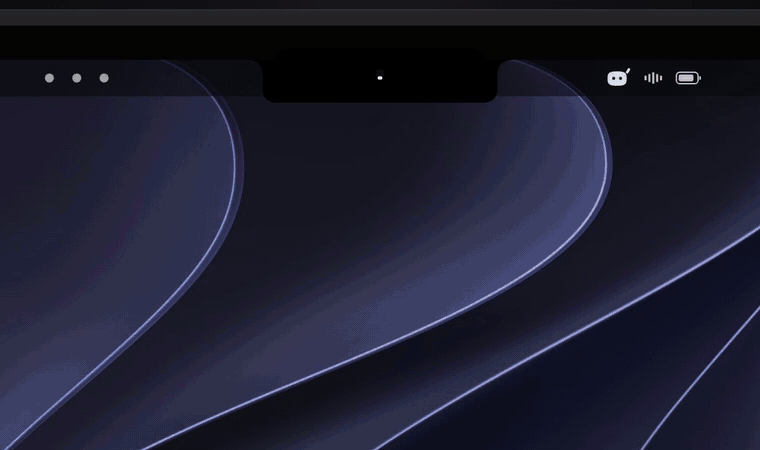

<div align="center">


# MyCoucou

**A tiny friend in your Mac's notch — one Mochi for every Claude Code session you run.**

Every coding agent you start gets its own character: its own name, its own colour, its own hat. See what it's reading, editing and running, approve what it asks, and answer from the notch — without leaving what you're doing.

[](https://github.com/goodends/MyCoucou/releases)




[English](README.md) · [简体中文](README.zh-CN.md)

</div>

---

> **This is an independent fork.** MyCoucou is built on [Coucou](https://github.com/Louis-CFM/coucou) by [Louis Raillé](https://louisraille.fr), whose work is under the MIT License. The source code here is a fork of his; the name is this fork's own, and Mochi, the icon, the sounds and the media remain his and are used unchanged — see [License](#license).

## One Mochi per session

This is the thing that makes MyCoucou different. It isn't one mascot with a list of tasks underneath — **each Claude Code session gets its own Mochi**, identified by the session id:

- **A name.** Rename it to whatever you call that piece of work; leave it blank and it falls back to the session name, then the project name.
- **A colour.** One of seven, picked at random on first sight, overridable any time.
- **An outfit.** Twelve of them — party hat, beanie, crown, sunglasses, round glasses, bow, scarf, witch hat, santa hat, bunny ears — plus seasonal dressing he picks on his own.

Sessions are matched by their **real identity**, not by guesswork: the id, cwd and transcript Claude Code already keeps at `~/.claude/sessions/<pid>.json`. Two sessions in one folder are two different sessions with two different characters.

## Features

- 🧠 **Sessions that report themselves.** MyCoucou scans the process table on launch, so a Claude Code session you started *before* opening the app is already there. A session whose process has died is marked stopped — it is not kept alive by optimism.
- 📂 **Grouped by folder.** The session list is keyed on the working directory, with a header per project.
- 🙈 **Hide and resume.** Park a session you don't care about; bring it back with Resume. If it died while hidden it returns marked stopped.
- ✅ **Approve from the notch.** Claude Code permission requests show **Allow / Deny** right in the island. `AskUserQuestion` prompts render in place, up to four questions, single or multi-select.
- 🩹 **Live diffs, per session.** Tap a session to see every file *it* edited, with +N −M each, newest first — tap a row for the full diff. In the ticker, tap the step itself to open that diff in place.
- 💬 **Read and reply to a session.** The chat pane loads the session's own transcript. Sending types into the terminal that hosts it — so sending needs **Orca**; jumping works from any host.
- 🪟 **Jump to where it runs.** Orca, Warp, Terminal, iTerm, Ghostty, cmux, or an editor — clicked straight from the session card.
- 🎙️ **Dictate.** Click the mic and talk; MyCoucou picks the language you spoke, or right-click to choose.
- ⌨️ **Nine global shortcuts** — open the island, jump to an alert, jump to a terminal, switch pill, mute, send Mochi to the desktop, open the wardrobe. All rebindable in Settings → Shortcuts.
- 🖥️ **Mochi on the desktop.** Drag him out of the island: he floats free, follows your cursor, flies home when you're idle and comes back where you left him.
- 🎭 **A real character.** Idle breathing, blinks, eyes projected on a sphere that track your mouse, emote when something finishes, go dizzy if you poke him too hard.
- 🔊 **29 sounds, and your own.** Drop a file named like one of them in Settings → General → Sound → **Open sounds folder**.
- 🌍 **10 languages** — English, 中文, हिन्द️, Español, العربية, Français, বাংলা, Português, Русू, Bahasa Indonesia — or just follow your system. Settings → General → Language.
- 🔒 **Private by design.** No telemetry, no account, no third-party network calls except the hooks you install.
- 🖥️ **Any Mac, notch or not.** iMac, Mac mini, or a closed-lid MacBook on an external display — Mochi moves to a bar at the top of the screen. Pick his screen in Settings → General, or let him follow your mouse.

## Supported agents

Claude Code · Cursor · Antigravity · Codex · Gemini CLI · Copilot CLI · Muse Code · OpenCode · Amp · Hermes · Claude Desktop

Each one gets its own pill in the island. Install them from Settings → Agents — the app shows you the exact diff before it writes anything to your agent's config, and keeps a dated backup.

## Install

### Download

Grab **`MyCoucou-1.0.0.dmg`** from [Releases](https://github.com/goodends/MyCoucou/releases/latest), double-click it, and drag **MyCoucou.app** into Applications.

The build is signed ad-hoc and not notarised, so the first launch asks you to confirm — click **Open** in the dialog, or right-click the app and choose Open. After that macOS leaves it alone.

**On first run, macOS treats this as a new app.** Path and signature both changed, so grant it again:

- **System Settings → Privacy & Security → Accessibility**
- **System Settings → Privacy & Security → Screen Recording**
- If MyCoucou is set to launch at startup, check **System Settings → General → Login Items** and delete any entry pointing at an old build.

### Build from source

**macOS** — macOS 15+, Xcode 16+, [XcodeGen](https://github.com/yonaskolb/XcodeGen).

```bash
brew install xcodegen
git clone https://github.com/goodends/MyCoucou.git
cd MyCoucou/NotchBuddy
xcodegen
xcodebuild -scheme NotchBuddy -configuration Debug build
```

To produce the installable DMG:

```bash
./scripts/package-dmg.sh
```

which builds Release, signs ad-hoc and writes `dist/MyCoucou-<version>.dmg`.

## Setup

Menu bar → **Settings…**. Three sections:

| Section | What's in it |
|---|---|
| **General** | sounds and volume · behaviour (open on hover, close after *n* seconds, hide after *n* seconds) · which screen Mochi lives on · island hotkey · launch at startup · language |
| **Agents** | install and update hooks for each supported agent — every write shows a diff and takes a dated backup first |
| **Shortcuts** | rebind the nine global shortcuts |

If MyCoucou isn't running, the hook exits immediately. **Your agent is never blocked.**

## How it works

- **The island** is a borderless `NSPanel` hugging the notch, driven by a small state machine (`hidden → petit → home`).
- **Mochi is drawn in code** — SwiftUI `Canvas` and `TimelineView` at 60 fps. Squircle body, eyes projected onto a sphere, spring physics. No Rive, no Lottie, no images. Outfits are 2.5D paths drawn on a rotating surface.
- **Sessions are discovered, not announced.** A process scan reads `ps`, `lsof` and `~/.claude/sessions/<pid>.json`, which is where Claude Code keeps the session id, cwd, name and status for every live process.
- **Hooks** are a tiny `nb-hook` script that forwards events over a Unix socket (`~/Library/Application Support/NotchBuddy/nb.sock`). For approvals it waits for your click, then answers — and exits at once if the app isn't there.
- **The wardrobe** is `MochiWardrobe.swift`; per-session state lives on `ClaudeSession`, keyed by session id.

Native Swift 6 / SwiftUI / AppKit, **zero third-party dependencies**.

## Contributing

Issues and PRs are welcome — new agents, emotes, sounds, translations, bug fixes. See [CONTRIBUTING.md](CONTRIBUTING.md).

Translations live in `NotchBuddy/Resources/Localizable.xcstrings`. All 290 strings ship complete in all 10 languages; a new string needs its translations before it lands, or it silently falls back to English on screen.

## Credits

Originally built by [Louis Raillé](https://louisraille.fr) with Claude Code. The rename to MyCoucou, the session-state work, the removal of the service integrations, the Mac-only drop and the DMG releases are this fork's, by [goodends](https://github.com/goodends/MyCoucou).

## License

- **Code:** [MIT](LICENSE) — use it, fork it, learn from it, just keep the copyright notice.
- **The name Coucou, Mochi, the icon, the sounds and the media:** © Louis Raillé, all rights reserved — see [LICENSE-ASSETS.md](LICENSE-ASSETS.md). This fork uses them unchanged and adds no rights of its own. **"MyCoucou"** is this fork's own name. Repackaging this fork means shipping Mochi again, which upstream reserves: read those terms, and ask upstream, before you publish.

<div align="center">

**If Mochi made you smile, a ⭐ helps a lot.**

[Website](https://goodends.github.io/MyCoucou/) · [Privacy](https://goodends.github.io/MyCoucou/privacy.html) · [Terms](https://goodends.github.io/MyCoucou/terms.html) · [Support](https://goodends.github.io/MyCoucou/support.html)

</div>