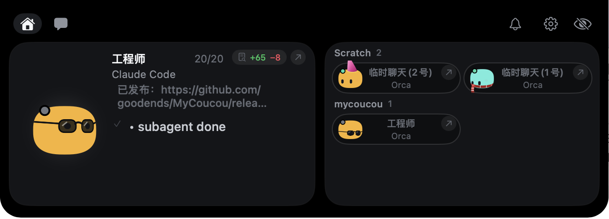
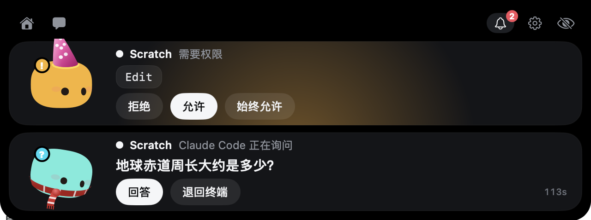
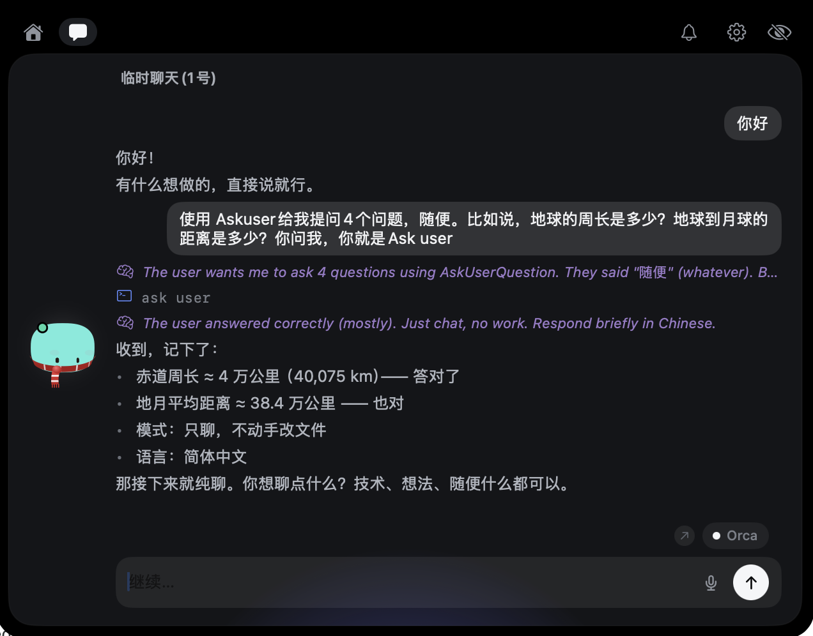

<div align="center">


# MyCoucou

**住在 Mac 刘海里的小伙伴 —— 你每开一个 Claude Code 会话，就有一个专属的 Mochi。**

你启动的每一个编程 agent 都有自己的角色：自己的名字、自己的颜色、自己的帽子。它在读什么、改什么、跑什么，你都能看到；它要你批准的东西，就在刘海里点一下。

[](https://github.com/goodends/MyCoucou/releases)






[English](README.md) · [简体中文](README.zh-CN.md)

</div>

---

> **这是一个独立 fork。** MyCoucou 基于 [Louis Raillé](https://louisraille.fr) 的 [Coucou](https://github.com/Louis-CFM/coucou) 开发，原项目采用 MIT 许可。这里的源码是他的 fork；名字是本 fork 自己取的，而 Mochi、图标、声音和媒体素材仍归他所有、按原样使用 —— 详见[许可](#许可协议)。

## 每个会话一个角色

这是 MyCoucou 和别的不一样的地方。它不是「一只吉祥物 + 底下一堆任务」，而是**每个 Claude Code 会话各有一个 Mochi**，按 session id 区分：

- **名字。** 改成你习惯叫这个活儿的名字；留空则依次回退到会话名、项目名。
- **颜色。** 七种颜色之一，第一次见到时随机分配，之后随时可以改。
- **装扮。** 十二种 —— 派对帽、毛线帽、皇冠、墨镜、圆框眼镜、蝴蝶结、围巾、巫师帽、圣诞帽、兔耳朵 —— 另外还有他会自己按季节换的应节装扮。

会话靠**真实身份**匹配，而不是靠猜：session id、cwd 和记录文件，都来自 Claude Code 自己在 `~/.claude/sessions/<pid>.json` 里的那份数据。同一个文件夹里的两个会话，就是两个不同的会话、两个不同的角色。

## 功能

- 🧠 **会话自己报状态。** 启动时扫一遍进程表，所以你在打开 app 之前就启动的 Claude Code 会话，一进来就已经在了。进程死掉的会话会被标记为已停止 —— 不会靠乐观硬撑。
- 📂 **按文件夹分组。** 会话列表按工作目录归类，每个项目一个标题。
- 🙈 **隐藏与恢复。** 把暂时不管的会话收起来；用 Resume 再放回来。如果它隐藏期间死掉了，回来时会被标记为已停止。
- ✅ **在刘海里批准。** Claude Code 的权限请求直接显示 **Allow / Deny**。`AskUserQuestion` 的选项也在原地呈现，最多四个问题，支持单选和多选。
- 🩹 **按会话看的实时 diff。** 点会话就能看到**它自己**改过的每个文件，带 `+N −M`，最近改的排最前 —— 点任一行看完整 diff。在滚动条上直接点那一步，也能就地打开对应的 diff。
- 💬 **读会话、回消息。** 聊天面板加载的就是该会话自己的记录。发送时会往承载它的终端里打字 —— 所以**发送需要 Orca**；跳转则支持任意 host。
- 🪟 **跳到它跑的地方。** Orca、Warp、Terminal、iTerm、Ghostty、cmux，或者编辑器 —— 从会话卡片直接点过去。
- 🎙️ **语音输入。** 点麦克风直接说，MyCoucou 会认出你说的语言；右键可以手动选。
- ⌨️ **9 个全局快捷键** —— 打开刘海、跳到提醒、跳到终端、切换 pill、静音、把 Mochi 放到桌面、打开衣柜。在 设置 → 快捷键 里全部可改。
- 🖥️ **桌面上的 Mochi。** 把他从刘海里拖出来：他会浮在桌面、跟着光标，闲置时飞回刘海，下次启动还在原位。
- 🎭 **一个真的角色。** 待机呼吸、眨眼、眼球投影到球面上追着你的鼠标看、做完事情会做表情、戳狠了会头晕。
- 🔊 **29 个音效，也能换成你自己的。** 在 设置 → 通用 → 声音 → **打开声音文件夹** 里放一个同名文件即可替换。
- 🌍 **10 种语言** — English、中文、हिन्द️、Español、العربية、Français、বাংলা、Português、Русский、Bahasa Indonesia —— 或者直接跟随系统。设置 → 通用 → 语言。
- 🔒 **隐私是设计出来的。** 无遥测、无账号，除你安装的 hook 之外不发起任何第三方网络请求。
- 🖥️ **任何 Mac，有没有刘海都行。** iMac、Mac mini，或者合盖外接显示器的 MacBook —— Mochi 会挪到屏幕顶部的一条小栏里。在 设置 → 通用 里指定他待在哪个屏幕，或者让他跟着鼠标走。

## 支持的 agent

Claude Code · Cursor · Antigravity · Codex · Gemini CLI · Copilot CLI · Muse Code · OpenCode · Amp · Hermes · Claude Desktop

每个都会在刘海里拿到自己的一枚 pill。在 设置 → Agents 里安装 —— 写入之前 app 会把完整 diff 给你看，并保留带日期的备份。

## 安装

### 下载安装

从 [Releases](https://github.com/goodends/MyCoucou/releases/latest) 下载 **`MyCoucou-1.0.0.dmg`**，双击打开，把 **MyCoucou.app** 拖进「应用程序」。

这个包是 ad-hoc 签名、未经公证的，所以第一次启动会要求你确认 —— 在弹窗里点**打开**，或者右键点 app 选「打开」。之后 macOS 就不再管它了。

**首次运行时，macOS 会把它当成一个全新的 app。** 路径和签名都变了，所以需要重新授权一次：

- **系统设置 → 隐私与安全性 → 辅助功能**
- **系统设置 → 隐私与安全性 → 屏幕录制**
- 如果你开了开机启动，检查一下 **系统设置 → 通用 → 登录项**，把指向旧构建的那条删掉。

### 从源码构建

**macOS** —— 需要 macOS 15+、Xcode 16+、[XcodeGen](https://github.com/yonaskolb/XcodeGen)。

```bash
brew install xcodegen
git clone https://github.com/goodends/MyCoucou.git
cd MyCoucou/NotchBuddy
xcodegen
xcodebuild -scheme NotchBuddy -configuration Debug build
```

要打出可安装的 DMG：

```bash
./scripts/package-dmg.sh
```

它会构建 Release、做 ad-hoc 签名，产出 `dist/MyCoucou-<版本号>.dmg`。

## 配置

菜单栏 → **设置…**，一共三个分区：

| 分区 | 内容 |
|---|---|
| **通用** | 声音与音量 · 行为（悬停时打开、无操作 *n* 秒后关闭、无活动 *n* 秒后隐藏）· Mochi 待在哪个屏幕 · 刘海快捷键 · 开机启动 · 语言 |
| **Agents** | 为每个支持的 agent 安装和更新 hook —— 每次写入都会先展示 diff 并保留带日期的备份 |
| **快捷键** | 重新绑定那 9 个全局快捷键 |

如果 MyCoucou 没在运行，hook 会立刻退出。**你的 agent 永远不会被卡住。**

## 工作原理

- **刘海**是一个贴着刘海的无边框 `NSPanel`，由一个很小的状态机驱动（`hidden → petit → home`）。
- **Mochi 是用代码画出来的** —— SwiftUI `Canvas` 配合 `TimelineView`，60 fps。圆角方身体、投影到球面的眼睛、弹簧物理。没有 Rive、没有 Lottie、没有位图。装扮是画在一个旋转曲面上的 2.5D 路径。
- **会话是被发现的，不是被通知的。** 进程扫描读取 `ps`、`lsof` 和 `~/.claude/sessions/<pid>.json` —— Claude Code 就是在那里为每个活着的进程保存 session id、cwd、名字和状态的。
- **Hook** 是一个小小的 `nb-hook` 脚本，通过 Unix socket（`~/Library/Application Support/NotchBuddy/nb.sock`）转发事件。遇到审批会等你点，然后再回复；如果 app 不在，它立刻退出。
- **衣柜**在 `MochiWardrobe.swift`；每个会话的状态挂在 `ClaudeSession` 上，按 session id 存。

原生 Swift 6 / SwiftUI / AppKit，**零第三方依赖**。

## 参与贡献

欢迎提 issue 和 PR —— 新的 agent、表情、音效、翻译、bug 修复都可以。详见 [CONTRIBUTING.md](CONTRIBUTING.md)。

翻译在 `NotchBuddy/Resources/Localizable.xcstrings` 里。290 条字符串在全部 10 种语言下都是完整的；新增字符串请连翻译一起提交，否则它在界面上会默默退回英文。

## 致谢

最初由 [Louis Raillé](https://louisraille.fr) 使用 Claude Code 开发。改名为 MyCoucou、会话状态这一整套工作、移除各家 service 集成、砍掉非 Mac 平台、以及 DMG 发布，都是本 fork 由 [goodends](https://github.com/goodends/MyCoucou) 完成的。

## 许可协议

- **代码：** [MIT](LICENSE) —— 拿去用、拿去改、拿去学，只要保留版权声明。
- **Coucou 这个名字、Mochi、图标、声音和媒体素材：** © Louis Raillé，保留所有权利 —— 详见 [LICENSE-ASSETS.md](LICENSE-ASSETS.md)。本 fork 原样使用它们，不主张任何额外权利。**「MyCoucou」**是本 fork 自己的名字。重新打包本 fork 就意味着再次分发 Mochi，而上游对此有保留：发布之前，请先读清那些条款，并向上游询问。

<div align="center">

**如果 Mochi 让你笑了一下，点个 ⭐ 会很有帮助。**

[网站](https://goodends.github.io/MyCoucou/) · [隐私](https://goodends.github.io/MyCoucou/privacy.html) · [条款](https://goodends.github.io/MyCoucou/terms.html) · [支持](https://goodends.github.io/MyCoucou/support.html)

</div>